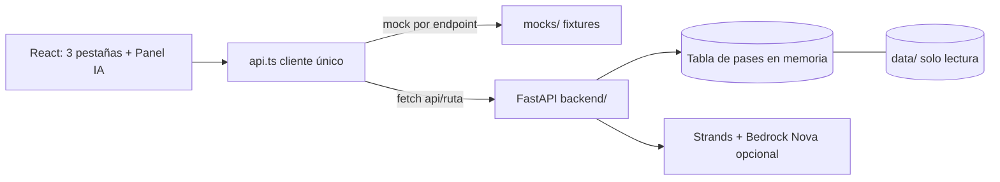

# Documento de Diseño: La Jugada Correcta

## Overview

SPA React + Vite servida por FastAPI desde `dashboard/dist`. El backend precalcula en memoria, al arrancar, una tabla de pases (una fila por pase) a partir de `data/`. El frontend consume la API con rutas relativas. Lenguaje dominante del workspace: TypeScript (frontend) y Python (backend). Este documento congela el contrato de API.

## Architecture



### Reglas de cálculo (backend, para Christian)

1. Tracking: `usecols` mínimo (gameId, playId, nflId, frameId, team, x, y, playDirection, event), `chunksize`, solo `event == "pass_forward"` y `"pass_arrived"` (igualdad exacta; existe `autoevent_passforward`). Normalizar a ataque hacia la derecha.
2. Candidatos: jugadores ofensivos con `pff_role == "Pass Route"`. Defensores: `pff_role == "Coverage"`.
3. Separación = distancia mínima del candidato a cualquier defensor Coverage en `pass_forward`.
4. Receptor elegido: apellido e inicial de `playDescription` contra `players.displayName` de los candidatos. Respaldo: candidato más cercano al balón en `pass_arrived` (`inferido=true` si se usó el respaldo).
5. Regret = máx separación − separación del elegido.
6. IC95 %: bootstrap percentil, 1000 remuestreos, semilla fija. Semáforo según Requisito 8.
7. Éxito, zona, lado: ver glosario en `requirements.md`.
8. Hallazgo de `resumen.titulo` y `recomendacion.accion` salen de reglas sobre estos agregados, no de la IA.

## Data Models

Contrato de API CONGELADO.

Convenciones: JSON UTF-8. `Textos` = `{"es": string, "en": string}`. Valores enumerados: `zona` ∈ `propia|medio|roja`; `lado` ∈ `izquierda|centro|derecha`; `cobertura` ∈ `todas|Man|Zone`; `confianza` ∈ `verde|amarillo|rojo`; `resultado.pase` ∈ `C|I|IN`.

### Tipos compartidos

```ts
type Textos = { es: string; en: string }
type Confianza = 'verde' | 'amarillo' | 'rojo'
type Zona = 'propia' | 'medio' | 'roja'
type Lado = 'izquierda' | 'centro' | 'derecha'
type Estimacion = {
  valor: number            // yardas (Regret) o proporción 0-1 (tasas)
  ic95: [number, number]   // [lo, hi]
  n: number
  concluyente: boolean     // false si n < 30
  confianza: Confianza     // n<30 rojo; 30-99 o IC ancho amarillo; n>=100 e IC angosto verde
}
type ErrorApi = { detail: string; codigo: string }
```

### Endpoints

| Método y ruta | Respuesta |
|---|---|
| `GET /health` | `{"status":"ok"}` |
| `GET /api/resumen` | `{titulo: Textos, linea: Textos, regret_liga: Estimacion, calidad_datos: {pct_objetivo_inferido: number}}` (porcentaje 0-100) |
| `GET /api/partidos` | `[{gameId: number, semana: number, local: string, visitante: string, n_pases: number}]` |
| `GET /api/partido/{gameId}/jugada/{n}` | `Jugada` (abajo). `n` empieza en 1. 404 si no existe. |
| `GET /api/partido/{gameId}/acumulado?hasta=n` | `Acumulado` (abajo) |
| `GET /api/partido/{gameId}/alertas?hasta=n` | `[{id: string, nivel: 'info'\|'atencion'\|'critica', titulo: Textos, texto: Textos, estimacion: Estimacion}]` |
| `GET /api/recomendacion?down=&yardsToGo=&zona=&cobertura=` | `{accion: Textos, porque: Textos, estimacion: Estimacion, comparables: Comparable[]}` |
| `GET /api/regret/equipos?zona=` | `[{equipo: string, estimacion: Estimacion}]` ordenado por `estimacion.valor` descendente. `zona` opcional (omitido = todas). |
| `GET /api/evidencia?down=&yardsToGo=&zona=` | `Evidencia` (abajo) |
| `GET /api/explicacion?down=&yardsToGo=&zona=&cobertura=` | `{texto: Textos, fuente: 'ia'\|'plantilla'}` |
| `POST /api/chat` body `{gameId: number, hasta: number, mensaje: string}` | `{respuesta: string, fuente: 'ia'\|'plantilla'}` |

Parámetros: `down` 1-4, `yardsToGo` 1-30, `hasta` entero ≥ 0 (0 = sin jugadas). `mensaje` 1-500 caracteres.

### Formas de objetos (definidas aquí porque el encargo solo las nombraba)

```ts
type Jugada = {
  n: number; total: number; gameId: number; playId: number
  cuarto: number
  ofensiva: string; defensiva: string            // abreviaturas de equipo
  down: number; yardsToGo: number; zona: Zona
  marcador: { local: number; visitante: number }  // antes de la jugada
  reloj: string                                    // "MM:SS"
  receptor_elegido: { nombre: string; posicion: string; inferido: boolean }
  receptor_mas_abierto: { nombre: string; posicion: string }
  separaciones: { nombre: string; posicion: string; separacion: number; elegido: boolean }[]
  regret: number                                   // yardas, >= 0
  lado: Lado
  resultado: { pase: 'C' | 'I' | 'IN'; yardas: number; exito: boolean }
}

type Acumulado = {
  hasta: number
  regret_total: number
  regret_medio: Estimacion
  por_zona: { zona: Zona; estimacion: Estimacion }[]
  por_lado: { lado: Lado; estimacion: Estimacion }[]
  serie: { n: number; acumulado: number }[]
}

type Comparable = { etiqueta: Textos; estimacion: Estimacion }  // valor = tasa de éxito

type Evidencia = {
  exito_por_zona: { zona: Zona; estimacion: Estimacion }[]
  exito_por_separacion: { rango: string; estimacion: Estimacion }[]  // "0-2","2-4","4+" yardas
  exito_por_cobertura: { cobertura: 'Man' | 'Zone'; estimacion: Estimacion }[]
}
```

### Errores

Todos los errores: `{"detail": string, "codigo": string}` con HTTP 400 (`PARAMETRO_INVALIDO`), 404 (`NO_ENCONTRADO`), 422 (`VALIDACION`), 500 (`ERROR_INTERNO`). La IA nunca devuelve error por falla de Bedrock: responde `fuente: "plantilla"`.

### Garantía de no filtrar el futuro

Con `hasta=n`, `acumulado`, `alertas` y `chat` usan solo jugadas con índice ≤ n. `jugada/{n}` no incluye datos de jugadas posteriores. Las alertas se generan por reglas (por ejemplo: Regret medio reciente en rojo, lado con más Regret, cambio entre mitades solo con n ≥ 30).

## Components and Interfaces

Frontend (Marianne, solo `dashboard/`).

### Estructura

```
dashboard/src/
  api.ts            cliente único; interruptor por endpoint (MOCK_ENDPOINTS)
  types.ts          tipos del contrato (copia de arriba)
  mocks/            fixtures con formas exactas
  i18n.ts           diccionario ES/EN + helper t()
  state.tsx         contexto en memoria: idioma, banda lateral, partido, n actual, panel IA
  components/       TarjetaResumen, Semaforo, EstimacionBadge, Cargando, Vacio, Error, Toggle...
  screens/          Inicio, SalaDecisiones, TableroRegret
  panel/            PanelIA (alertas, preguntas, chat)
```

- `api.ts` usa `fetch('api/...')` sin diagonal inicial. El interruptor por endpoint se controla con `VITE_USE_MOCKS` (por defecto `true` hasta que el endpoint exista; cambiar por endpoint en `MOCK_ENDPOINTS`). `VITE_*` se define en un `.env` dentro de `dashboard/` (no versionado) o en el código.
- Hook `useApi(fn, deps)` devuelve `{estado: 'cargando'|'vacio'|'error'|'ok', datos, error, reintentar}`.
- Estilos: Tailwind 3 (`@tailwind base/components/utilities` en `index.css`), fuente del sistema, sin CDN. Modo banda lateral: clase `banda` en la raíz que sube el tamaño de texto, contraste y oculta secciones de evidencia.
- Semáforo: ícono (● verde ✔, ▲ amarillo, ✖ rojo, en SVG/emoji local) + texto "Confiable / Con reservas / No concluyente".
- Layout: móvil una columna (375 px), pestañas inferiores; escritorio ≥1024 px con columna lateral del Panel IA. Móvil: botón flotante abre el drawer con `role="dialog"`.
- Avance automático: `setInterval` de 3 s, limpiado al pausar o desmontar.

### Mocks

`mocks/` contiene al menos: 1 `resumen`, 3 `partidos`, 12 jugadas de un partido, `acumulado` por `hasta`, 3 alertas (una por nivel), `recomendacion` con n=12 (rojo), n=60 (amarillo) y n=240 (verde), 8 equipos en `regret/equipos`, `evidencia`, `explicacion` con ambas fuentes y `chat` con ambas fuentes. Además un caso vacío (`comparables: []`) y un caso de error simulado.

## Error Handling

- Cargando: esqueleto con `aria-busy`. Vacío: texto "Sin jugadas con esos filtros". Error: mensaje `detail` + botón Reintentar. Fallo del panel IA aislado con su propio estado.
- Parámetros fuera de rango se bloquean en la UI y los valida Pydantic en backend.

## Correctness Properties

### Property 1: Propiedad 1

**Validates: Requirements 8.2, 8.3, 8.4**

Para toda `Estimacion`: `n < 30` implica `confianza = rojo` y `concluyente = false`. (pytest en backend; el frontend lo asegura al mostrar "aún no es concluyente" cuando `!concluyente`).
### Property 2: Propiedad 2

**Validates: Requirements 3.4**

Para todo `n` y `hasta=n`: ningún dato de respuesta depende de jugadas con índice mayor que `n`.
### Property 3: Propiedad 3

**Validates: Requirements 3.2**

`regret ≥ 0` y `regret = max(separaciones) − separación del elegido`.
### Property 4: Propiedad 4

**Validates: Requirements 3.5**

El acumulado a `hasta=n` es la suma de los `regret` de las jugadas 1..n.
### Property 5: Propiedad 5

**Validates: Requirements 9.3, 10.4**

Ninguna ruta del frontend empieza con `/`, ni contiene `localhost` ni `http`.
### Property 6: Propiedad 6

**Validates: Requirements 10.7**

Toda respuesta del frontend se renderiza en los 3 estados (cargando, vacío, error) sin lanzar excepciones.

## Testing Strategy

- Backend: pytest + httpx para las propiedades 1-4 y para el formato de errores.
- Frontend: `npm run build` (TypeScript estricto) tras cada paso; revisión manual a 375 px, modo banda lateral, ES/EN y teclado. Sin librerías de pruebas nuevas.
