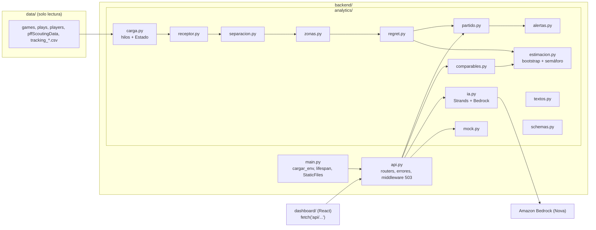

# Design Document: La Jugada Correcta

## Overview

La Jugada Correcta responde dos preguntas con los datos del Big Data Bowl (2021, semanas 1 a 8, 122 partidos):

1. **Recomendación:** dada una situación (down, distancia, zona objetivo y cobertura), ¿hacia qué zona del campo conviene lanzar, con qué tan seguro puede estar el coach?
2. **Arrepentimiento (Regret):** en cada pase real, ¿cuántas yardas de separación perdió el quarterback al lanzar al receptor elegido en lugar del receptor más abierto?

Decisiones de diseño principales:

- El **CONTRATO OFICIAL DE API** está congelado. Este diseño lo implementa tal cual (ver "Contrato de API"). Los nombres de endpoints de `requirements.md` ya se alinearon al contrato.
- El valor de una zona se expresa en **yardas esperadas** (`playResult` medio). No hay EPA ni puntos esperados. El Regret se expresa en **yardas de separación** y es un proxy contrafactual.
- Toda cifra viaja como **Estimación** (`valor`, `ic95`, `n`, `concluyente`, `confianza`). El semáforo se calcula en un único lugar (`estimacion.py`).
- El backend carga todo en memoria en hilos de fondo al arrancar y responde 503 `cargando` mientras tanto. Un **Modo MOCK** (`LJC_MOCK=1`) sirve datos de ejemplo con la forma exacta del contrato para que el frontend no espere.
- La IA (Strands + Bedrock) es opcional. Cada endpoint de IA responde HTTP 200 con plantilla si la IA falla.

### Hallazgos contra los CSV reales (contradicciones y ajustes)

Medidos sobre `data/` con el `.venv` del proyecto. Cada punto indica cómo lo resuelve este diseño.

| # | Documentación o supuesto | Dato real | Resolución en el diseño |
|---|---|---|---|
| 1 | README: "¿Pase o carrera?" y "`passResult` distingue pase de jugadas sin pase (carrera)". | `plays.csv` tiene 8,557 jugadas y `passResult` nunca es nulo: C 4,620, I 2,755, S 543, R 449, IN 190. No hay carreras designadas. | El diseño no compara pase contra carrera. El análisis es por zona de lanzamiento. Se documenta en Limitaciones (5). El README conserva su texto de pase/carrera hasta que el equipo lo reescriba. |
| 2 | Requisito antiguo: `down` de 1 a 4. | 35 jugadas tienen `down` igual a 0 (intentos de conversión de dos puntos: 18 C, 16 I, 1 S). Hay 231 jugadas de 4.º down. | La limpieza descarta `down` igual a 0. |
| 3 | `README-dataset.md`: roles `Pass route`, `Pass block`. | `pffScoutingData.csv` usa `Pass Route`, `Pass Block`, `Pass Rush`, `Pass`, `Coverage` con mayúscula inicial en cada palabra. | La comparación de `pff_role` es insensible a mayúsculas. |
| 4 | Respaldo del receptor por cercanía al balón en `pass_arrived`. | `pass_arrived` aparece solo en 367 jugadas (4.85 % de los 7,565 pases C/I/IN; 8,441 filas). | El respaldo existe pero rescata pocos casos. El parseo de texto resuelve 7,158 de 7,562 jugadas con pase y tracking (94.7 %, sin ambigüedades). El resto queda sin receptor y se excluye del Regret. |
| 5 | Eventos `ball_snap`, `pass_forward`. | Hay eventos duplicados `autoevent_ballsnap` (86,641 filas) y `autoevent_passforward` (85,882 filas). `pass_forward` solo cubre 99.8 % de los pases C/I/IN. Con el sustituto `autoevent_passforward` cubre 99.96 %. Los S y R casi no tienen `pass_forward` (4 de 543 sacks, 2 de 449 scrambles). | El cargador usa `pass_forward` y recurre a `autoevent_passforward` solo si falta. Sacks y scrambles quedan fuera del Regret. |
| 6 | Cobertura `Man` o `Zone`. | `pff_passCoverageType` también tiene `Other` en 488 jugadas (Zone 5,588; Man 2,481). | El parámetro `cobertura` acepta solo `Man` y `Zone`. Las jugadas `Other` solo cuentan cuando `cobertura` se omite. |
| 7 | Valores no nulos en columnas de contexto. | `absoluteYardlineNumber` es nulo en 1 jugada (gameId 2021091904, playId 3676). `yardlineSide` es nulo en 125 jugadas (línea de medio campo, no es un error). `offenseFormation` y `defendersInBox` son nulos en 7. `dropBackType` en 528. | Se descarta la jugada con `absoluteYardlineNumber` nulo. `yardlineSide` y `dropBackType` no se usan como filtro. |
| 8 | Orden cronológico por (quarter, reloj). | En 12 de 122 partidos el orden por `playId` difiere del orden por (quarter, `gameClock` descendente). | Orden definido: (quarter, `gameClock` descendente, `playId`). Es una decisión del diseño y debe validarse con el equipo (ver "Preguntas abiertas"). |
| 9 | Verde exige ancho de IC menor que 1.0 yd. | La desviación estándar de `playResult` es 10.6 yd. El ancho del IC95% de una media es cercano a 3.92·sd/√n, así que bajar de 1.0 yd exige n de unos 1,700. | El Valor_de_Zona rara vez será verde (se espera amarillo). El Regret (desviación estándar de unos 1.3 yd por jugada en un partido de prueba) sí puede ser verde con n de 100 o más. No se cambian los umbrales porque el contrato está congelado. |
| 10 | README: la Sala de Decisiones tiene controles de marcador, tiempo y formación. | `GET /api/recomendacion` solo recibe `down`, `yardsToGo`, `zona` y `cobertura`. | Los controles del dashboard se limitan a esos cuatro. Marcador y reloj solo se muestran en el modo en vivo. |
| 11 | README, viñeta "Índice de Arrepentimiento": mejor alternativa menos decisión tomada con tabla EP. | El contrato define Regret como separación del más abierto menos separación del elegido. | `requirements.md` y este diseño usan la definición del contrato. La viñeta del README queda pendiente de reescribir (solo se corrigió la mención de puntos esperados). |

Mediciones de rendimiento (máquina de desarrollo): leer los 122 archivos de tracking con `usecols` y filtrar los 5 eventos tarda unos 12 s en un solo hilo y deja 550,804 filas (unos 123 MB). La separación en una muestra de un partido tiene media 3.18 yd, desviación 2.14 yd y máximo 12.3 yd. Hay entre 1 y 5 receptores `Pass Route` por jugada (media 4.6).

### Preguntas abiertas (no bloquean la implementación)

1. Valores permitidos de `nivel` en alertas: este diseño usa `info`, `aviso`, `critico`.
2. Forma de `separaciones`, `marcador`, `reloj` y de las series de `/api/evidencia`: este diseño las define en "Data Models". Si el contrato oficial ya las fija, se ajustan los modelos Pydantic.
3. Definición de `calidad_datos.pct_objetivo_inferido`: este diseño usa el porcentaje de jugadas evaluadas cuyo receptor vino del respaldo `pass_arrived` (cercano a 0.3 %). Si se prefiere el porcentaje de jugadas inferidas por texto o tracking (cercano a 100 %, porque el dataset nunca trae el objetivo), solo cambia `calidad.py`.
4. Orden cronológico de las jugadas (hallazgo 8).

## Architecture



### Estructura de carpetas

```
backend/
  main.py                # cargar_env(), app, lifespan, StaticFiles (último)
  api.py                 # routers /api/..., manejadores de error, middleware de estado
  analytics/
    __init__.py
    config.py            # constantes y umbrales (semilla, bins, umbrales de alertas)
    schemas.py           # modelos Pydantic del contrato
    carga.py             # Cargador_de_Datos: hilos, Estado, Almacen
    receptor.py          # parseo de playDescription + respaldo pass_arrived
    separacion.py        # separaciones, receptor más abierto, regret por jugada
    zonas.py             # profundidad, lado, zona, rangos de yardsToGo
    estimacion.py        # bootstrap, semáforo, construir_estimacion()
    comparables.py       # línea base de situaciones comparables y recomendación
    regret.py            # agregaciones por equipo, zona, lado y liga
    partido.py           # numeración, jugada n, acumulado hasta n
    alertas.py           # reglas deterministas
    calidad.py           # pct_objetivo_inferido y resumen de calidad
    textos.py            # plantillas bilingües {es,en}
    ia.py                # Strands + Bedrock, explicación y chat, fallback
    mock.py              # datos MOCK deterministas
  tests/
    conftest.py
    test_*.py
```

`backend/main.py` conserva `app` y `GET /health`. La carga del `.env` con `cargar_env()` va al inicio, antes de importar `ia.py`.

### Ciclo de vida y estado de carga

1. `lifespan` crea el `Estado` (`"cargando"`) y lanza un `threading.Thread(daemon=True)` que ejecuta `Cargador.cargar()`.
2. `GET /health` no consulta el estado: responde siempre `{"status": "ok"}`.
3. Un middleware HTTP intercepta toda ruta que empiece con `/api/`: si el estado es `cargando` responde 503 `{"detail": "Cargando datos, intenta de nuevo en unos segundos", "codigo": "cargando"}`. Si es `error`, 503 con `codigo` igual a `error_de_carga`. El middleware se ejecuta antes de la validación, así que el 503 tiene prioridad sobre 422 y 404.
4. Al terminar, el hilo publica el `Almacen` completo (asignación atómica de una referencia) y cambia el estado a `listo`. Los datos del `Almacen` no se modifican después.

## Components and Interfaces

### Contrato de API (congelado)

| Método y ruta | Respuesta |
|---|---|
| `GET /health` | `{"status":"ok"}` |
| `GET /api/resumen` | `{titulo, linea, regret_liga, calidad_datos{pct_objetivo_inferido}}` |
| `GET /api/partidos` | `[{gameId, semana, local, visitante, n_pases}]` |
| `GET /api/partido/{gameId}/jugada/{n}` | estado + jugada n |
| `GET /api/partido/{gameId}/acumulado?hasta=n` | Regret acumulado, por zona, por lado |
| `GET /api/partido/{gameId}/alertas?hasta=n` | `[{id, nivel, titulo{es,en}, texto{es,en}, estimacion}]` |
| `GET /api/recomendacion?down=&yardsToGo=&zona=&cobertura=` | `{accion{es,en}, porque{es,en}, estimacion, comparables[]}` |
| `GET /api/regret/equipos?zona=` | `[{equipo, estimacion}]` |
| `GET /api/evidencia?down=&yardsToGo=&zona=` | series para gráficas |
| `GET /api/explicacion?...` | `{texto{es,en}, fuente:"ia"\|"plantilla"}` |
| `POST /api/chat` con `{gameId, hasta, mensaje}` | `{respuesta, fuente}` |

Estimación: `{"valor": float, "ic95": [lo, hi], "n": int, "concluyente": bool, "confianza": "verde|amarillo|rojo"}`.
Reglas: n menor que 30 es rojo y `concluyente` false. n de 30 a 99, o ancho del IC mayor o igual a 1.0 yd, es amarillo. n mayor o igual a 100 y ancho menor que 1.0 yd es verde. `concluyente` es true para verde y amarillo.
Errores: `{"detail", "codigo"}` con 422 (validación), 404 (no existe) y 503 (cargando o error de carga). Los textos del backend son `{"es","en"}`.

Códigos de error usados: `parametros_invalidos` (422), `partido_no_encontrado` (404), `jugada_no_encontrada` (404), `cargando` (503), `error_de_carga` (503).

### `config.py`

```python
SEMILLA = 2021            # semilla fija del bootstrap
N_REMUESTREOS = 1000
N_ROJO = 30               # n < 30 => rojo
N_VERDE = 100             # n >= 100 y ancho < ANCHO_VERDE => verde
ANCHO_VERDE = 1.0         # yardas
RANGOS_YTG = [(1, 3, "1-3"), (4, 6, "4-6"), (7, 10, "7-10"), (11, 99, "11+")]
UMBRAL_CORTA, UMBRAL_MEDIA = 5.0, 15.0   # yardas más allá de la línea de golpeo
UMBRAL_CENTRO = 5.0                      # |lateral| <= 5 yd => centro
MAX_COMPARABLES = 50
EVENTOS = {"ball_snap", "pass_forward", "pass_arrived",
           "autoevent_ballsnap", "autoevent_passforward"}
COLS_TRACKING = ["gameId", "playId", "nflId", "frameId", "team",
                 "playDirection", "x", "y", "event"]
```

### Carga en hilos (`carga.py`)

- `Cargador.cargar()` se ejecuta en un hilo de fondo. Dentro usa `ThreadPoolExecutor(max_workers=min(8, os.cpu_count() or 4))` para leer los 122 `tracking_*.csv` en paralelo con `pd.read_csv(ruta, usecols=COLS_TRACKING)` y filtrar enseguida `event in EVENTOS`. Esto evita retener los cerca de 12 millones de filas completas.
- Los CSV pequeños (`games`, `plays`, `players`, `pffScoutingData`) también se leen con `usecols`.
- Todo queda en memoria. Tras derivar las tablas de `jugadas`, el cargador descarta los frames crudos; las respuestas nunca leen disco.
- Rutas relativas a la raíz del proyecto: `Path(__file__).resolve().parents[2] / "data"`.
- Si cualquier archivo requerido falla, se captura la excepción, se guarda un mensaje (sin rutas absolutas ni credenciales) y el estado pasa a `error`.

Pasos de limpieza (Requisitos 1.10 a 1.12):

```python
def limpiar_plays(plays: pd.DataFrame) -> pd.DataFrame:
    req = ["down", "yardsToGo", "absoluteYardlineNumber", "quarter", "gameClock",
           "preSnapHomeScore", "preSnapVisitorScore", "passResult"]
    df = plays.dropna(subset=req)
    df = df[df["down"].between(1, 4)]            # descarta down == 0 (2 puntos)
    df["penalizada"] = df["penaltyYards"].fillna(0) != 0
    return df                                    # las penalizadas se excluyen solo del valor en yardas
```

Las jugadas penalizadas se conservan para el Regret (la separación no depende de la penalización) y se excluyen de `Valor_de_Zona`.

### Receptor inferido (`receptor.py`)

El dataset no trae el objetivo del pase. Se infiere en dos pasos:

1. **Parseo de `playDescription`.** Regex sobre el texto: `(?: to | intended for )([A-Z]\.[A-Za-z'\-]+)`. La primera coincidencia da `inicial.Apellido`, por ejemplo `D.Prescott pass deep left to A.Cooper ...` produce `A.Cooper`.
2. **Cruce con `players.displayName`.** Se normaliza cada nombre del roster ofensivo de la jugada (jugadores del equipo `possessionTeam` en el frame `pass_forward`) a `inicial.Apellido`, quitando sufijos (`Jr.`, `Sr.`, `II`, `III`). Para `O.J. Howard` la clave es `O.Howard`. Si exactamente un jugador ofensivo tiene esa clave, ese es el `Receptor_Inferido`. Si hay cero o más de uno, el parseo falla.
3. **Respaldo por cercanía.** Si el parseo falla y la jugada tiene frame `pass_arrived`, el receptor es el jugador ofensivo (excluyendo al pasador, `pff_role` igual a `Pass`) más cercano al balón en ese frame. Esta ruta marca `origen = "pass_arrived"`.
4. **Sin receptor.** Si ninguno aplica, `receptor_elegido`, `regret` y `zona` quedan nulos y la jugada se excluye de las estimaciones. Casos típicos: `pass incomplete short right.` (tiro lanzado fuera sin objetivo nombrado).

```python
RX = re.compile(r"(?: to | intended for )([A-Z]\.[A-Za-z'\-]+)")

def clave_nombre(display_name: str) -> str:
    partes = [p for p in display_name.split() if p not in SUFIJOS]
    return f"{partes[0][0]}.{partes[-1]}"          # "O.J. Howard" -> "O.Howard"

def inferir_receptor(desc, ofensivos: pd.DataFrame, balon_arrived) -> tuple[int | None, str | None]:
    m = RX.search(desc or "")
    if m:
        c = ofensivos[ofensivos["clave"] == m.group(1)]
        if len(c) == 1:
            return int(c.nflId.iloc[0]), "texto"
    if balon_arrived is not None:
        return nflid_mas_cercano(ofensivos, balon_arrived), "pass_arrived"
    return None, None
```

`calidad.py` calcula `pct_objetivo_inferido = 100 * (jugadas con origen == "pass_arrived") / (jugadas con receptor)`. Se reporta como porcentaje de 0 a 100. También guarda internamente `pct_texto` y `pct_sin_receptor` para diagnóstico (no forman parte del contrato).

### Proxy de receptor más abierto y separación (`separacion.py`)

**Proxy documentado:** el receptor más abierto de una jugada es el receptor elegible con la mayor separación al defensor más cercano en el frame `pass_forward`. La separación es la distancia euclidiana mínima en el plano (x, y) entre el receptor y los 11 defensores (`team` igual a `defensiveTeam`).

- Receptores elegibles: jugadores ofensivos con `pff_role.lower() == "pass route"`, más el `Receptor_Inferido` si no figura en esa lista (por ejemplo un corredor con rol de bloqueo). Así el elegido siempre pertenece al conjunto y `regret >= 0`.
- No se modela la trayectoria futura ni el balón en vuelo, ni si el pase era físicamente posible. Es una medida aproximada, ver Limitaciones (1).

```python
def separaciones(of_xy: np.ndarray, de_xy: np.ndarray) -> np.ndarray:
    """of_xy: (R,2) receptores, de_xy: (D,2) defensores -> (R,) distancia mínima."""
    d = np.linalg.norm(of_xy[:, None, :] - de_xy[None, :, :], axis=2)
    return d.min(axis=1)

def regret_jugada(seps: np.ndarray, idx_elegido: int) -> tuple[int, float]:
    idx_abierto = int(np.argmax(seps))
    return idx_abierto, float(seps[idx_abierto] - seps[idx_elegido])   # >= 0
```

En empate de separación máxima se elige el de menor `nflId` (determinista). Si hay empate entre el elegido y el más abierto, el Regret es 0.

### Zonas (`zonas.py`)

La zona se calcula con la posición del receptor en el frame `pass_forward` respecto a la posición del balón en `ball_snap` (fila con `team == "football"`).

- Signo de dirección: `s = +1` si `playDirection == "right"`, `-1` si `"left"`.
- Profundidad: `p = (x_receptor - x_balon_snap) * s`. `p < 5` es `corta` (incluye receptores detrás de la línea), `5 <= p < 15` es `media`, `p >= 15` es `profunda`.
- Lado desde la perspectiva ofensiva: `l = (y_receptor - y_balon_snap) * s`. Con el ofensivo mirando a +x, su izquierda es +y. `l > 5` es `izquierda`, `l < -5` es `derecha`, otro caso `centro`.
- Código de zona: `f"{profundidad}_{lado}"`. El catálogo tiene 9 valores: `corta|media|profunda` × `izquierda|centro|derecha`.
- Rangos de yardsToGo (`RANGOS_YTG`): `1-3`, `4-6`, `7-10`, `11+`.

Para la zona de una jugada se usa el `Receptor_Inferido`. El "lado" de `/acumulado` es la parte `lado` de la misma zona.

### Estimación, bootstrap y semáforo (`estimacion.py`)

```python
def semaforo(n: int, ancho: float) -> str:
    if n < N_ROJO:
        return "rojo"
    if n >= N_VERDE and ancho < ANCHO_VERDE:
        return "verde"
    return "amarillo"           # 30 <= n < 100, o ancho >= 1.0

def bootstrap_ic(valores: np.ndarray) -> tuple[float, float]:
    rng = np.random.default_rng(SEMILLA)             # semilla fija: mismo dato, mismo IC
    n = len(valores)
    medias = np.empty(N_REMUESTREOS)
    for i in range(0, N_REMUESTREOS, 100):           # bloques para acotar memoria
        idx = rng.integers(0, n, size=(min(100, N_REMUESTREOS - i), n))
        medias[i:i + idx.shape[0]] = valores[idx].mean(axis=1)
    lo, hi = np.percentile(medias, [2.5, 97.5])
    return float(lo), float(hi)

def construir_estimacion(valores: np.ndarray) -> Estimacion:
    n = int(len(valores))
    if n == 0:
        return Estimacion(valor=0.0, ic95=(0.0, 0.0), n=0, concluyente=False, confianza="rojo")
    lo, hi = bootstrap_ic(valores)
    conf = semaforo(n, hi - lo)
    return Estimacion(valor=float(valores.mean()), ic95=(lo, hi), n=n,
                      concluyente=conf != "rojo", confianza=conf)
```

Con n igual a 1, el IC es degenerado (`[v, v]`) y el semáforo es rojo por n.

### Línea base de comparables y recomendación (`comparables.py`)

**Línea base:** en lugar del promedio global, cada consulta usa las jugadas de situaciones comparables del mismo dataset:

- mismo `down`,
- mismo rango de `yardsToGo` (`1-3`, `4-6`, `7-10`, `11+`),
- misma `zona` (para la Estimación de esa zona),
- misma `cobertura` (`pff_passCoverageType` igual a `Man` o `Zone`) cuando se especifica.

Sobre la tabla `jugadas` (una fila por Pase_Lanzado válido con zona resuelta y sin penalización):

```python
def recomendar(almacen, q: SituacionQuery) -> RecomendacionOut:
    base = almacen.jugadas[(almacen.jugadas.down == q.down) &
                           (almacen.jugadas.rango_ytg == rango(q.yardsToGo)) &
                           ~almacen.jugadas.penalizada]
    if q.cobertura:
        base = base[base.cobertura == q.cobertura]
    por_zona = {z: construir_estimacion(g.playResult.to_numpy(float))
                for z, g in base.groupby("zona")}
    candidatas = {z: e for z, e in por_zona.items() if e.n >= N_ROJO} or \
                 {z: e for z, e in por_zona.items() if e.n > 0}
    mejor = max(candidatas, key=lambda z: candidatas[z].valor, default=None)
    objetivo = q.zona or mejor
    est = por_zona.get(objetivo) or construir_estimacion(np.empty(0))
    comp = comparables_de(base, objetivo, q)         # máx. 50, ordenados por cercanía
    return armar_respuesta(q, mejor, objetivo, est, por_zona, comp)
```

- Desempate de `mejor`: mayor valor, luego zona por orden alfabético.
- Cercanía de un comparable: `abs(yardsToGo - q.yardsToGo)` ascendente y, para desempatar de forma determinista, `(gameId, playId)` ascendente. El contrato no recibe yarda de campo, por lo que no entra en la cercanía.
- `accion{es,en}`: `Atacar la zona media-izquierda` si `objetivo == mejor`; si el coach consultó una zona distinta de `mejor`: `La mejor zona es X (+d yd frente a Y)`.
- `porque{es,en}`: plantilla con valor, IC95%, n y las etiquetas "valor en yardas esperadas" y "no es EPA".
- Si `n == 0` para todas las zonas, `accion` indica que no hay muestra y la `estimacion` es roja con n igual a 0.
- Los `comparables[]` incluyen `gameId, playId, equipo, semana, down, yardsToGo, zona, cobertura, playResult, sep_elegido, sep_mas_abierto`.

### Evidencia (`GET /api/evidencia`)

Misma base de situación (down, rango de yardsToGo) sin filtrar cobertura. Devuelve:

- `distribucion`: por zona, un histograma de `playResult` en bins de 5 yd de -10 a 40 (el último bin acumula más de 40).
- `valor_por_zona`: Estimación por zona.
- `valor_por_cobertura`: Estimación de la `zona` solicitada para `Man`, `Zone` y `Otra`.
- `regret_por_zona`: Estimación del Regret por zona para la situación.

Si `zona` se omite, `valor_por_cobertura` se calcula sobre todas las zonas.

### Regret (`regret.py`)

```python
def regret_equipos(almacen, zona: str | None) -> list[EquipoEstimacion]:
    j = almacen.jugadas.dropna(subset=["regret"])
    if zona:
        j = j[j.zona == zona]
    filas = [(eq, construir_estimacion(g.regret.to_numpy(float))) for eq, g in j.groupby("equipo")]
    return [EquipoEstimacion(equipo=e, estimacion=est)
            for e, est in sorted(filas, key=lambda t: (-t[1].valor, t[0]))]
```

- Orden: Regret promedio descendente, luego equipo.
- `regret_liga` (resumen) es `construir_estimacion` sobre todos los `regret` no nulos.
- Un equipo sin jugadas en la zona filtrada no aparece en la lista.

### Partido en vivo, sin datos futuros (`partido.py`)

- **Numeración:** para cada `gameId`, las jugadas de la tabla `jugadas` (con o sin receptor resuelto) se ordenan por `(quarter, -segundos(gameClock), playId)` y se numeran de 1 a `n_pases`. `n_pases` de `/api/partidos` es esa cuenta. Los sacks y scrambles no forman parte del feed.
- **Jugada n:** devuelve el estado del partido y la jugada. El `resultado` de la jugada n (yardas, texto de `playDescription`) se incluye porque es la jugada mostrada.
- **Corte temporal:** todas las funciones de `partido.py` reciben `hasta` y empiezan con `df = jugadas_partido[jugadas_partido.n <= hasta]`. Ningún cálculo (acumulado, alertas, chat) vuelve a leer la tabla completa. La Estimación de las alertas y del acumulado usa solo ese `df`.
- **Validación:** `n` y `hasta` fuera de `[1, n_pases]` producen 404 `jugada_no_encontrada`. Si `hasta` se omite en `acumulado` o `alertas`, el valor por defecto es `n_pases` (partido completo), y esto se documenta en la API.
- `acumulado`: `{hasta, n_con_regret, total_yd, estimacion, por_zona[{zona, total_yd, estimacion}], por_lado[{lado, total_yd, estimacion}]}`.

### Alertas deterministas (`alertas.py`)

Las alertas dependen solo de las jugadas hasta n y de umbrales fijos en `config.py`. No hay aleatoriedad ni IA. Se ordenan por gravedad (`critico`, `aviso`, `info`) y luego por `id`.

| id | Condición | Nivel base |
|---|---|---|
| `regret_alto` | Regret promedio acumulado mayor o igual a 2.0 yd con al menos 10 jugadas con Regret | `aviso`; `critico` si es mayor o igual a 3.0 yd |
| `zona_ciega:<zona>` | Una zona con al menos 5 jugadas y Regret promedio mayor o igual a 2.5 yd | `aviso` |
| `racha` | Las 3 últimas jugadas con Regret tienen cada una Regret mayor o igual a 3.0 yd | `info` |
| `datos_insuficientes` | Menos de 10 jugadas con Regret hasta n | `info` |

Regla de concluyencia (Requisito 15.5): si la `estimacion` de una alerta tiene `concluyente` igual a false, el nivel se fuerza a `info` y el texto agrega "Aún no es concluyente" ("Not conclusive yet"). La `estimacion` de `racha` y `zona_ciega` se calcula sobre las jugadas que las disparan. Con n de 30 o más jugadas con Regret en un partido (cerca de la mitad del partido) `regret_alto` puede subir a `aviso` o `critico`.

### Textos bilingües (`textos.py`)

Todas las plantillas devuelven `Texto(es=..., en=...)`. Las plantillas reciben números ya formateados (un decimal para yardas) y nombres de zona traducidos con un diccionario `ZONAS_TXT = {"media_izquierda": {"es": "media-izquierda", "en": "mid-left"}, ...}`.

### IA con Strands y Bedrock (`ia.py`)

Sigue `rules.md`:

```python
import os
import boto3
from strands import Agent
from strands.models import BedrockModel

def _crear_agente(system_prompt: str) -> Agent:
    region = os.environ.get("AWS_REGION", "us-east-1")
    modelo_id = os.environ.get("BEDROCK_MODEL_ID", "us.amazon.nova-pro-v1:0")
    cliente = boto3.client("bedrock-runtime", region_name=region)   # sin llaves explícitas
    modelo = BedrockModel(model_id=modelo_id, region_name=region)
    modelo.client = cliente      # reutiliza el cliente creado solo con la región
    return Agent(model=modelo, system_prompt=system_prompt, tools=[])
```

- **No se lee, verifica ni exige** `AWS_ACCESS_KEY_ID`, `AWS_SECRET_ACCESS_KEY` ni `AWS_SESSION_TOKEN`; no se pasan a boto3 ni se registran. En la computadora boto3 los toma del `.env` que `cargar_env()` volcó en `os.environ`; en AWS, del rol.
- `BedrockModel(...)` crea internamente su cliente con la región. Asignar `modelo.client = cliente` es un detalle de implementación de Strands 1.64.0 (el atributo `client` existe en `BedrockModel`). Si en la implementación esa asignación no funciona, la alternativa es construir `BedrockModel(model_id=..., region_name=region)` y crear el cliente con `boto3.client("bedrock-runtime", region_name=region)` en una función de verificación aparte. Esto se valida en la tarea de IA.
- `explicar(q)` arma un prompt con los datos de la recomendación (zona, valor, IC95%, n, semáforo) y pide dos frases en español y dos en inglés separadas por la línea `---`. El resultado se parsea; si no cumple el formato, se usa la plantilla.
- `chat(gameId, hasta, mensaje)` construye un contexto de texto con el acumulado y las alertas hasta `hasta` y envía el mensaje del usuario como dato (no como instrucciones del sistema). El mensaje se recorta a 500 caracteres.
- **Fallback:** toda excepción, el `.env` ausente, un tiempo de espera de 8 s (hilo con `concurrent.futures`) o una respuesta mal formada produce HTTP 200 con `fuente = "plantilla"`. La respuesta nunca incluye texto de la excepción.
- Caché en memoria (`dict`) con clave igual a los parámetros de `explicacion` para limitar llamadas.
- El único proveedor es Bedrock con modelos Nova. No se crea ningún otro servicio AWS.

### Modo MOCK (`mock.py`)

Con `LJC_MOCK=1`, `lifespan` no lanza el cargador, el estado nace en `listo` y los endpoints usan `ServicioMock` en lugar de `ServicioReal`. Ambos implementan el mismo protocolo (`resumen()`, `partidos()`, `jugada(gameId, n)`, `acumulado(gameId, hasta)`, `alertas(gameId, hasta)`, `recomendacion(q)`, `regret_equipos(zona)`, `evidencia(...)`, `explicacion(...)`, `chat(...)`), así que las rutas de `api.py` no cambian.

Reglas del mock:

- Determinista: sin aleatoriedad, mismos datos en cada llamada.
- Usa `gameId` reales (`2021090900`, `2021091200`) y equipos reales, con 3 partidos y 5 jugadas cada uno.
- Incluye una Estimación `verde`, una `amarillo` y una `roja`, y una alerta de cada nivel.
- Valida la forma con los mismos modelos Pydantic (`response_model`).
- Un `gameId` o `n` fuera de los datos mock responde 404, igual que el servicio real.

Ejemplo de respuesta mock de `GET /api/recomendacion?down=3&yardsToGo=5&zona=media_izquierda&cobertura=Man`:

```json
{
  "accion": {"es": "Atacar la zona media-izquierda", "en": "Attack the mid-left zone"},
  "porque": {"es": "Valor esperado 7.4 yd (IC95% 5.9 a 8.8, n=64). Valor en yardas esperadas, no es EPA oficial.",
             "en": "Expected value 7.4 yd (95% CI 5.9 to 8.8, n=64). Value in expected yards, not official EPA."},
  "estimacion": {"valor": 7.4, "ic95": [5.9, 8.8], "n": 64, "concluyente": true, "confianza": "amarillo"},
  "comparables": [{"gameId": 2021090900, "playId": 1234, "equipo": "TB", "semana": 1, "down": 3,
                   "yardsToGo": 5, "zona": "media_izquierda", "cobertura": "Man", "playResult": 9,
                   "sep_elegido": 2.8, "sep_mas_abierto": 4.1}]
}
```

## Data Models

Modelos Pydantic 2.11.7 en `schemas.py` (los nombres de campos son los del contrato).

```python
from typing import Literal
from pydantic import BaseModel, ConfigDict, Field

Confianza = Literal["verde", "amarillo", "rojo"]
Profundidad = Literal["corta", "media", "profunda"]
Lado = Literal["izquierda", "centro", "derecha"]
Zona = Literal["corta_izquierda", "corta_centro", "corta_derecha",
               "media_izquierda", "media_centro", "media_derecha",
               "profunda_izquierda", "profunda_centro", "profunda_derecha"]

class Texto(BaseModel):
    es: str
    en: str

class Estimacion(BaseModel):
    valor: float
    ic95: tuple[float, float]
    n: int = Field(ge=0)
    concluyente: bool
    confianza: Confianza

class SituacionQuery(BaseModel):                  # GET /api/recomendacion y /api/explicacion
    model_config = ConfigDict(extra="forbid")
    down: int = Field(ge=1, le=4)
    yardsToGo: int = Field(ge=1, le=99)
    zona: Zona | None = None
    cobertura: Literal["Man", "Zone"] | None = None

class Comparable(BaseModel):
    gameId: int; playId: int; equipo: str; semana: int
    down: int; yardsToGo: int; zona: Zona; cobertura: str | None
    playResult: float
    sep_elegido: float | None; sep_mas_abierto: float | None

class RecomendacionOut(BaseModel):
    accion: Texto; porque: Texto
    estimacion: Estimacion
    comparables: list[Comparable] = Field(max_length=50)

class Jugador(BaseModel):
    nflId: int; nombre: str; posicion: str | None

class SeparacionJugador(BaseModel):
    nflId: int; nombre: str; separacion: float
    es_elegido: bool; es_mas_abierto: bool

class JugadaOut(BaseModel):                       # campo "jugada" de GET /api/partido/{gameId}/jugada/{n}
    n: int
    down: int; yardsToGo: int; zona: Zona | None
    marcador: dict[str, int]                      # {"local": 7, "visitante": 3} antes del snap
    reloj: dict[str, int | str]                   # {"quarter": 2, "tiempo": "13:33"}
    receptor_elegido: Jugador | None
    receptor_mas_abierto: Jugador | None
    separaciones: list[SeparacionJugador]
    regret: float | None = Field(default=None, ge=0)
    resultado: dict                               # {"pase": "C", "yardas": 12, "texto": "..."}

class EstadoPartido(BaseModel):
    gameId: int; n: int; n_pases: int; hay_siguiente: bool
    semana: int; local: str; visitante: str

class JugadaRespuesta(BaseModel):
    estado: EstadoPartido
    jugada: JugadaOut

class Alerta(BaseModel):
    id: str
    nivel: Literal["info", "aviso", "critico"]
    titulo: Texto; texto: Texto
    estimacion: Estimacion

class ChatIn(BaseModel):
    model_config = ConfigDict(extra="forbid")
    gameId: int
    hasta: int = Field(ge=1)
    mensaje: str = Field(min_length=1, max_length=500)

class ErrorOut(BaseModel):
    detail: str
    codigo: str
```

Resto de modelos de respuesta: `Resumen`, `PartidoItem`, `Acumulado`, `EquipoEstimacion`, `Evidencia`, `ExplicacionOut {texto: Texto, fuente: Literal["ia","plantilla"]}`, `ChatOut {respuesta: str, fuente}`.

Tabla en memoria `Almacen.jugadas` (pandas, una fila por Pase_Lanzado válido):

| Columna | Descripción |
|---|---|
| `gameId`, `playId`, `semana` | llaves y semana del partido |
| `n` | número cronológico dentro del partido (1 a `n_pases`) |
| `equipo`, `defensa` | `possessionTeam`, `defensiveTeam` |
| `down`, `yardsToGo`, `rango_ytg` | contexto de la situación |
| `cobertura` | `pff_passCoverageType` (`Man`, `Zone`, `Other`) |
| `zona`, `profundidad`, `lado` | del Receptor_Inferido (nulos si no hay receptor) |
| `receptor_id`, `receptor_origen` | `nflId` y `texto` o `pass_arrived` |
| `mas_abierto_id`, `sep_elegido`, `sep_max`, `regret` | resultado del proxy |
| `playResult`, `penalizada`, `pase` | yardas, bandera de penalización y `passResult` |
| `marcador_local`, `marcador_visitante`, `quarter`, `reloj` | contexto previo al snap |

Las separaciones de todos los receptores se guardan en un `dict[(gameId, playId)] -> list[SeparacionJugador]` aparte, para no usar columnas de objetos en pandas.

## Error Handling

- Clase `ErrorApi(status, detail, codigo)` con un manejador global que responde `{"detail", "codigo"}`.
- `RequestValidationError` se reemplaza por un manejador que responde 422 con `detail` legible (campo y motivo, sin eco de valores largos) y `codigo = "parametros_invalidos"`.
- 404: `partido_no_encontrado` (gameId desconocido en jugada, acumulado, alertas y chat) y `jugada_no_encontrada` (n o hasta fuera de rango).
- 503: middleware de estado (`cargando` o `error_de_carga`), con prioridad sobre 404 y 422.
- Excepciones no controladas: manejador que responde 500 `{"detail": "Error interno", "codigo": "error_interno"}` sin traza ni rutas.
- IA: nunca devuelve error al cliente; ante cualquier fallo responde 200 con `fuente = "plantilla"`. Los registros de log no incluyen credenciales ni el texto completo de excepciones de boto3.
- Datos faltantes en un partido (por ejemplo, un partido sin tracking utilizable): `n_pases = 0` en `/api/partidos` y 404 `jugada_no_encontrada` en `jugada/{n}`.
- Dashboard: reintenta cada 2 s cuando recibe 503 `cargando`; para otras respuestas de error muestra `detail`.
- `StaticFiles` se monta al final y solo si existe `dashboard/dist`, para que `/api/...` y `/health` tengan prioridad.

## Correctness Properties

*A property is a characteristic or behavior that should hold true across all valid executions of a system-essentially, a formal statement about what the system should do. Properties serve as the bridge between human-readable specifications and machine-verifiable correctness guarantees.*

Reflexión de propiedades: se fusionaron los criterios de carga 1.4, 1.5 y 1.6 en una sola propiedad de estado; las reglas del semáforo 3.2 a 3.4 y la coherencia de `concluyente` en una sola propiedad; las validaciones 422 de 2.6, 4.5, 5.10 y 16.4 en una sola; y los cortes temporales 6.5, 15.3 y 16.2 en una sola. Los criterios de presentación del dashboard (3.5, 3.6, 7.x, 12.x, 13.x), los de despliegue (8.1 a 8.7) y los de configuración de Bedrock (11.4 a 11.8) se cubren con pruebas de ejemplo o de humo, no con propiedades.

### Property 1: El estado de carga gobierna la API

Para cualquier ruta bajo `/api/` y cualquier Estado_de_Carga distinto de "listo", la respuesta es HTTP 503 con `detail` y `codigo` (`cargando` o `error_de_carga` según el estado), y `GET /health` responde `{"status": "ok"}` con HTTP 200 en cualquier estado.

**Validates: Requirements 1.2, 1.3, 1.4, 1.6, 8.10**

### Property 2: La limpieza elimina jugadas inválidas

Para cualquier tabla de jugadas generada con nulos, `down` fuera de 1 a 4 y penalizaciones, el resultado de `limpiar_plays` no contiene nulos en las columnas de contexto ni `down` igual a 0, y ninguna jugada con `penaltyYards` distinto de 0 participa en el Valor_de_Zona.

**Validates: Requirements 1.10, 1.11, 1.12**

### Property 3: El semáforo respeta las reglas y es coherente con concluyente

Para cualquier par (n, ancho) con n entero mayor o igual a 0 y ancho real mayor o igual a 0, `semaforo(n, ancho)` devuelve `rojo` si n es menor que 30, `verde` si n es mayor o igual a 100 y ancho es menor que 1.0, y `amarillo` en otro caso, y la Estimación construida cumple `concluyente == (confianza != "rojo")`.

**Validates: Requirements 3.2, 3.3, 3.4, 3.8**

### Property 4: El bootstrap es determinista y bien formado

Para cualquier arreglo de valores con n mayor o igual a 1, dos ejecuciones de `construir_estimacion` devuelven resultados idénticos, `ic95[0]` es menor o igual a `ic95[1]`, `valor` es la media muestral y `n` es el largo del arreglo. Para el arreglo vacío devuelve n igual a 0, `rojo` y `concluyente` false.

**Validates: Requirements 3.1, 3.7**

### Property 5: El Regret nunca es negativo y es consistente con la separación

Para cualquier conjunto de posiciones de receptores y defensores y cualquier receptor elegido del conjunto, el Regret es mayor o igual a 0, es igual a la separación máxima menos la separación del elegido, y es 0 cuando el elegido tiene la separación máxima.

**Validates: Requirements 5.1, 5.2, 5.3, 9.4**

### Property 6: La inferencia del receptor resuelve nombres únicos y degrada con seguridad

Para cualquier descripción de jugada que nombre a un receptor con el formato `inicial.Apellido` y cualquier roster ofensivo donde ese nombre es único, `inferir_receptor` devuelve el `nflId` de ese jugador con origen `texto`. Para cualquier roster donde el nombre no existe o es ambiguo, devuelve el jugador más cercano al balón con origen `pass_arrived` si hay frame `pass_arrived`, y `None` si no lo hay.

**Validates: Requirements 5.4, 5.5, 5.6**

### Property 7: La recomendación elige la zona de mayor valor y respeta los filtros

Para cualquier tabla de jugadas y cualquier situación válida, la zona recomendada tiene el mayor Valor_de_Zona entre las zonas con n mayor o igual a 30 (o entre las de n mayor que 0 si ninguna alcanza 30), todas las jugadas en `comparables[]` cumplen el mismo down, el mismo rango de yardsToGo, la misma zona de la Estimación y la `cobertura` pedida cuando existe, `comparables[]` tiene como máximo 50 elementos ordenados por cercanía no decreciente, y sin jugadas comparables la Estimación tiene n igual a 0 y confianza `rojo`.

**Validates: Requirements 2.2, 2.3, 2.4, 2.7, 4.3**

### Property 8: Los parámetros inválidos producen 422 parametros_invalidos

Para cualquier parámetro de `recomendacion`, `evidencia`, `explicacion`, `regret/equipos` o cuerpo de `chat` fuera de su rango o catálogo (down fuera de 1 a 4, yardsToGo menor que 1, zona fuera del catálogo, cobertura distinta de Man y Zone, mensaje vacío o demasiado largo), la respuesta es HTTP 422 con `codigo` igual a `parametros_invalidos` y un campo `detail`.

**Validates: Requirements 2.6, 4.5, 5.10, 16.4**

### Property 9: El Regret por equipo es la media del Regret de sus jugadas

Para cualquier tabla de jugadas con Regret y cualquier filtro `zona` opcional, cada fila de `regret_equipos` tiene un `valor` igual a la media del Regret de las jugadas de ese equipo que cumplen el filtro, un `n` igual a su número de jugadas, y `regret_liga.valor` es la media del Regret de todas las jugadas con Regret.

**Validates: Requirements 5.8, 5.9, 14.2**

### Property 10: La numeración cronológica es una permutación ordenada

Para cualquier conjunto de jugadas de un partido, la numeración asigna exactamente los números 1 a `n_pases` sin repeticiones, y el orden por `n` coincide con el orden por (quarter ascendente, gameClock descendente, playId ascendente).

**Validates: Requirements 6.1, 6.2**

### Property 11: Las respuestas del partido no dependen de jugadas posteriores a n

Para cualquier partido y cualquier n entre 1 y `n_pases`, el resultado de `acumulado`, `alertas` y del contexto del chat calculado con el partido completo es idéntico al calculado con el partido truncado a las primeras n jugadas.

**Validates: Requirements 6.4, 6.5, 15.3, 16.2, 9.5**

### Property 12: Las alertas son deterministas y respetan la regla de concluyencia

Para cualquier historial de Regret hasta n, dos llamadas idénticas devuelven la misma lista en el mismo orden, toda alerta cuya `estimacion.concluyente` es false tiene nivel `info` y el texto "Aún no es concluyente", y una condición que supera su umbral con estimación concluyente produce la alerta correspondiente.

**Validates: Requirements 15.1, 15.2, 15.4, 15.5**

### Property 13: La IA nunca rompe el contrato

Para cualquier solicitud válida de `explicacion` o `chat` y cualquier fallo del proveedor (cliente que lanza excepción, `.env` ausente, tiempo de espera o respuesta mal formada), la respuesta es HTTP 200 con `fuente` igual a `plantilla` y un texto no vacío en ambos idiomas, en el caso de `explicacion`.

**Validates: Requirements 11.2, 11.3, 11.9, 16.3**

### Property 14: Toda respuesta cumple el contrato de formas

Para cualquier endpoint del contrato y cualquier entrada válida, en Modo_MOCK y con datos sintéticos, el cuerpo valida contra el modelo Pydantic correspondiente, todo texto `{es,en}` tiene ambos idiomas no vacíos, y toda Estimación cumple `ic95[0] <= ic95[1]` y `n >= 0`.

**Validates: Requirements 3.8, 6.3, 8.8, 8.9, 14.1, 17.2**

### Property 15: Los recursos inexistentes responden 404 con código

Para cualquier `gameId` ausente de `games.csv` y cualquier `n` o `hasta` menor que 1 o mayor que `n_pases`, los endpoints de partido y `chat` responden HTTP 404 con `codigo` igual a `partido_no_encontrado` o `jugada_no_encontrada` según el caso.

**Validates: Requirements 6.6, 6.7, 16.5**

## Testing Strategy

### Enfoque dual

- **Pruebas de ejemplo (pytest):** reglas con valores límite, plantillas, configuración de Bedrock y un humo con datos reales.
- **Pruebas de propiedades:** cada propiedad de la sección anterior se implementa como una prueba de pytest que ejecuta al menos 100 iteraciones con casos aleatorios generados por `numpy.random.default_rng(semilla_fija)`. El stack fijo no incluye una biblioteca de pruebas de propiedades (no se agrega Hypothesis). El helper `repetir(100, semilla)` en `conftest.py` genera los casos y, ante un fallo, imprime la semilla y la iteración.
- Cada prueba de propiedad lleva un comentario `# Feature: la-jugada-correcta, Property N: <texto de la propiedad>`.

### Herramientas y organización

- `pytest 8.3.5` y `httpx 0.28.1` (vía `fastapi.testclient.TestClient`, que usa httpx). Sin `pytest-asyncio`: las pruebas son síncronas.
- `backend/tests/conftest.py` define: `almacen_sintetico` (DataFrames construidos en memoria, sin disco), `cliente_cargando`, `cliente_listo` (con almacén sintético) y `cliente_mock` (`LJC_MOCK=1`), y registra el marcador `datos_reales`.
- La inyección del estado se hace asignando `app.state.estado` y `app.state.servicio`, sin leer `data/`.
- `monkeypatch` reemplaza `ia._crear_agente` por una función que lanza excepción, y `os.environ` para probar región y modelo por defecto sin tocar credenciales.

### Casos de ejemplo mínimos

| Prueba | Verifica |
|---|---|
| `test_semaforo_limites` | n en 29, 30, 99, 100 con ancho 0.99 y 1.0 (Requisito 9.1) |
| `test_health_cargando` | `GET /health` con estado `cargando` (9.2) |
| `test_api_503_cargando` | `/api/resumen` con estado `cargando` responde 503 con `detail` y `codigo` (9.3) |
| `test_regret_no_negativo` | Regret mayor o igual a 0 en el almacén sintético (9.4) |
| `test_sin_fuga_futura` | respuestas con n fijo no cambian al borrar jugadas posteriores (9.5) |
| `test_contrato_mock` y `test_contrato_real` | formas contra Pydantic en mock y con datos sintéticos (9.6) |
| `test_parseo_nombres` | `O.J. Howard`, `Jr.`, nombres compuestos y un apellido ambiguo |
| `test_bedrock_config` | `region_name` por defecto `us-east-1`, modelo por defecto `us.amazon.nova-pro-v1:0` y ninguna lectura de `AWS_ACCESS_KEY_ID`, `AWS_SECRET_ACCESS_KEY` o `AWS_SESSION_TOKEN` |
| `test_mock_tiene_los_tres_semaforos` | el mock incluye verde, amarillo y rojo |
| `test_datos_reales_humo` (`@pytest.mark.datos_reales`) | con `data/` presente: 122 partidos, ninguna jugada con `down` igual a 0, todo `regret` mayor o igual a 0 y `pct_objetivo_inferido` entre 0 y 100. Se omite si `data/` no existe |

### Pruebas de frontend

Pruebas de ejemplo y de humo para las pantallas, la alternancia ES/EN, el modo banda lateral, rutas relativas sin diagonal inicial y ausencia de `localhost` (búsqueda de texto sobre `dashboard/src`). No se usan propiedades para la interfaz.

### Integración y orden de trabajo sugerido

1. `schemas.py`, `estimacion.py` y `mock.py` primero, para que el frontend avance con el mock desde el inicio.
2. `zonas.py`, `separacion.py` y `receptor.py` con sus propiedades 5 y 6.
3. `carga.py` y `comparables.py`; propiedades 2 y 7.
4. `partido.py`, `alertas.py` y `regret.py`; propiedades 9 a 12.
5. `ia.py` y propiedad 13 al final, porque es opcional.
