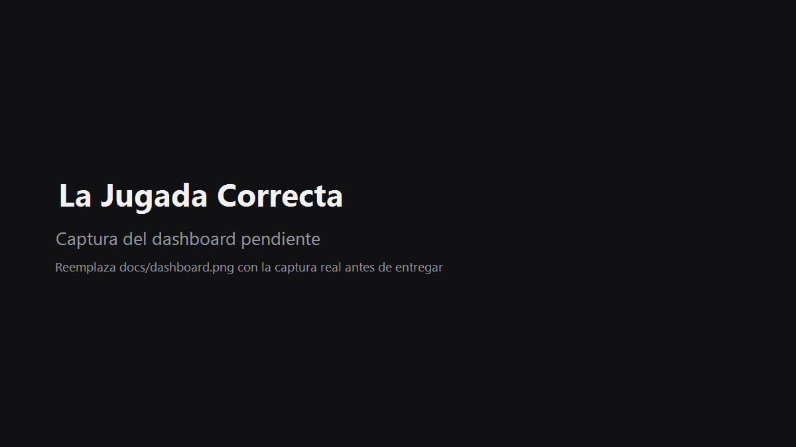

# La Jugada Correcta

**Una línea:** Le dice a un coach de la NFL qué decisión conviene tomar en una situación de juego, con qué tan seguro puede estar y cómo se compara con lo que los equipos realmente hicieron.

> NFL Big Data Bowl · UNAM 2026 · Equipo ENES Juriquilla



<!-- TODO antes de entregar: sube una captura real a docs/dashboard.png y una línea de conclusión en la sección "Hallazgo". -->

## El problema

En la banda, un coach tiene segundos para decidir. La pregunta que responde esta app:

> **¿Pase o carrera, según down, distancia, yarda de campo, marcador y tiempo?**
> Y cuando hay tracking: **¿cambia la recomendación según formación y movimiento pre-snap?**

No es un tablero de estadísticas: es una recomendación accionable con su porqué, su tamaño de muestra y su incertidumbre.

## Para quién

Para un **coach ofensivo** que necesita decidir en el momento, no para un analista que explora datos.

## Qué muestra (4 pantallas)

1. **Inicio** — el hallazgo principal en un titular y una tarjeta de resumen de una línea.
2. **Sala de Decisiones** — controles de la situación (down, distancia, yarda, marcador, tiempo, formación) → recomendación **pase/carrera**, semáforo de confianza y muestra.
3. **Evidencia** — gráficas de Recharts y jugadas comparables de situaciones parecidas.
4. **Tablero de Arrepentimiento** — ranking del Índice de Arrepentimiento por equipo y por situación, con filtro.

## Hallazgo

**Pendiente de escribir con el resultado final.** Formato sugerido: una frase con la recomendación y el tamaño del efecto (ej. "En 3.ª y 1, el pase rinde X puntos esperados más que la carrera en N jugadas, IC 95 % [a, b]"). Los jueces leen esto primero.

## Datos

Solo lectura, en `data/` (no se versionan en git; el `.zip` de entrega sí los incluye). Fuente: `nfl-big-data-bowl-regional-event-data`.

| Archivo | Llaves | Uso |
|---|---|---|
| `games.csv` | `gameId` | equipo local/visitante, semana, fecha |
| `plays.csv` | `gameId`, `playId` | **contexto de decisión**: `down`, `yardsToGo`, `yardlineNumber`, `yardlineSide`, `absoluteYardlineNumber`, `quarter`, `gameClock`, `preSnapHomeScore`, `preSnapVisitorScore`, `possessionTeam`, `defensiveTeam`, `playResult`, `passResult`, `offenseFormation`, `personnelO`, `defendersInBox`, `pff_passCoverage*` |
| `players.csv` | `nflId` | posición y nombre del jugador |
| `pffScoutingData.csv` | `gameId`, `playId`, `nflId` | rol (`pff_role`), alineación, presión |
| `tracking/tracking_[gameId].csv` | `gameId`, `playId`, `nflId` | posición/velocidad por frame (`x`, `y`, `s`, `a`, `o`, `dir`), `event`, `playDirection` |

Detalle completo de columnas: [`data/README-dataset.md`](data/README-dataset.md).

## Cómo calculamos (y qué asumimos)

- **Valor de una jugada:** el dataset **no trae EPA**, así que estimamos **puntos esperados (EP)** con una tabla situación → puntos esperados construida con las propias jugadas comparables (down, distancia, yarda absoluta, marcador, tiempo). Es una aproximación, no EPA oficial; queda documentada en `design.md`.
- **Línea base:** jugadas de **situaciones comparables** del mismo dataset, no el promedio global.
- **Incertidumbre:** bootstrap sobre las jugadas comparables → intervalo de confianza. **Siempre** mostramos tamaño de muestra y el IC.
- **Muestra chica:** si N está por debajo del umbral acordado, la app dice **"aún no es concluyente"** y semáforo rojo.
- **Semáforo de confianza:** verde / amarillo / rojo según tamaño de muestra y amplitud del IC.
- **Índice de Arrepentimiento:** para cada jugada real, `valor de la mejor alternativa − valor de la decisión tomada`, agregado por equipo y por situación. Es contrafactual estimado con la tabla de EP, no el resultado observado de una jugada que no se jugó.
- **Clasificación pase/carrera:** `passResult` distingue pase (C/I/S/IN/R) de jugadas sin pase (carrera); se valida contra `playDescription`. Supuesto documentado.
- **Limpieza:** descartar jugadas sin contexto completo, penalizaciones que distorsionan, y `NaN` en las columnas de decisión. Sin escribir en disco: todo se calcula al arrancar o al responder.

## Cómo correrlo

Backend (desde la raíz del proyecto):

```
.\.venv\Scripts\python.exe -m uvicorn backend.main:app --reload
```

Dashboard (desarrollo):

```
cd dashboard
npm run dev
```

Producción: `vite build` genera `dashboard/dist` y el servidor lo sirve junto con la API en la misma URL. El dashboard llama a la API con rutas **relativas sin diagonal inicial** (`fetch('api/...')`), nunca `localhost` ni `127.0.0.1`.

Verificar entorno: `.\.hackathon\setup.cmd --check`. Generar entrega: `.\.hackathon\setup.cmd --entregar`.

## Stack

Python 3.12.12 · FastAPI 0.115.14 · Uvicorn 0.34.3 · Pydantic 2.11.7 · pandas 2.2.3 · numpy 2.1.3 · pytest 8.3.5 · httpx 0.28.1 · Node 22.23.1 · React 18.3.1 · Vite 5.4.21 · TypeScript 5.7.3 · Tailwind CSS 3.4.19 · Recharts 3.10.1. IA opcional: Strands Agents 1.64.0 + boto3 1.44.0 con Amazon Bedrock (Nova). Sin Docker y sin dependencias extra.

## Producto

- **Mobile-first**: diseñado para 375 px, con modo banda lateral compacto.
- **Accesible**: contraste alto, textos grandes, sin depender de fuentes ni CDN externos.
- **Bilingüe ES/EN** con un botón.
- **IA opcional**: `POST /api/explicacion` redacta el porqué en dos frases con Bedrock Nova; si falla, responde una explicación por plantilla y la app sigue funcionando.

## Equipo

- Christian Alexis Ramírez Conejo — ENES Juriquilla, UNAM
